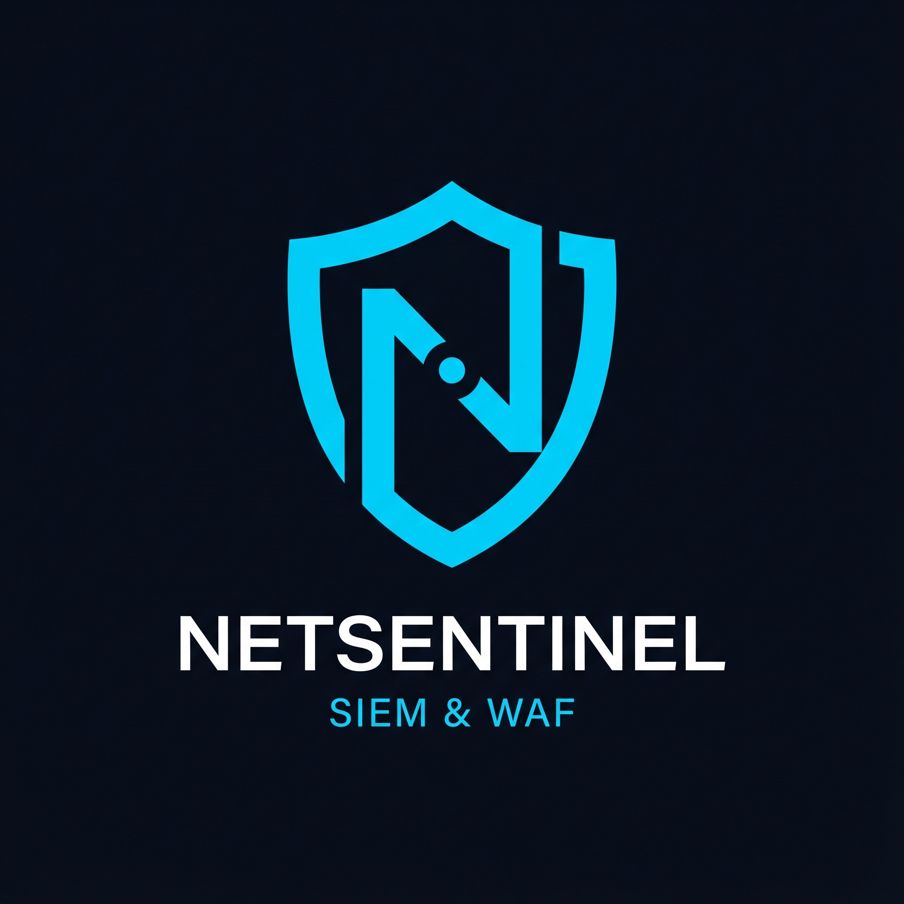
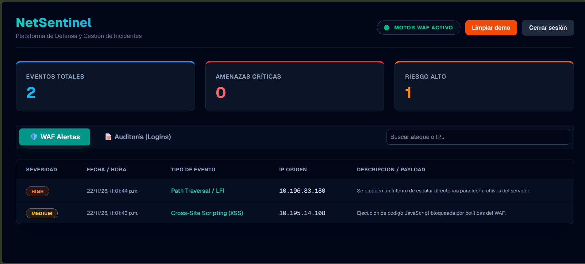

# NetSentinel — Backend API (WAF & SIEM)

API REST en **Node.js y Express** con inspección perimetral **WAF** (`wafMiddleware`), mitigación de fuerza bruta (`loginLimiter`), autenticación mediante **JWT** y **bcryptjs**, cabeceras de seguridad con **Helmet**, **CORS** restringido y persistencia en **PostgreSQL (Neon / Docker)**.

## Enlaces del Proyecto
- **Backend API (Render):** https://seguridadinform-ticaproyectobackend.onrender.com
- **Frontend SOC (Vercel):** https://seguridad-inform-tica-proyecto-fron.vercel.app
- **Repositorio Frontend:** https://github.com/torao12/SeguridadInform-ticaProyectoFrontend

## Controles de Seguridad Implementados
- **WAF (`wafMiddleware`):** Bloqueo (`HTTP 403`) ante SQLi, XSS, Path Traversal/LFI, Command Injection y bots, con registro en `alerts`.
- **Rate Limiting (`loginLimiter`):** Control de intentos fallidos en `/api/auth/login` (`HTTP 429`) con `trust proxy` y ventana/umbral configurables.
- **Autenticación y Auditoría:** Hashes con `bcryptjs`, verificación `JWT` en rutas protegidas y trazabilidad en `audit_logs`.
- **Endurecimiento HTTP:** `Helmet` y `CORS` delimitado al origen autorizado.

## Vista Previa

## Autor y Contexto Académico
- **Autor:** Ian Mauricio Morales Montejo (Matrícula: 243737)
- **Programa:** Ingeniería en Tecnologías de la Información e Innovación Digital — Grupo 7B
- **Asignatura:** Seguridad Informática (Periodo 263) — Universidad Politécnica de Chiapas
- **Docente:** M.C. José Alonso Macías Montoya
